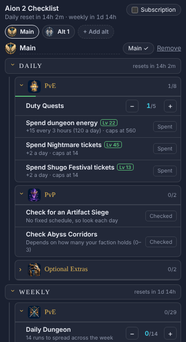

# Aion 2 Checklist

A daily and weekly checklist for Aion 2, as a plugin for the [A2Tools DPS Meter](https://a2tools.app). Track every character in one panel next to the meter, with the official resets built in.



## What it does

- **Daily and Weekly**, each split into **PvE** and **PvP**, plus Crafting & Shopping and Optional Extras.
- **One tab per character.** Mark one as your main; alts only show what counts separately for each character.
- **Resets itself** at the official times: daily at 07:00 UTC, weekly on Wednesday at 07:00 UTC.
- **Subscription switch** for the higher energy and Shugo caps and the Subscriber Shop's Odyle Energy.
- **Fully manual.** It reads nothing from the game: you tick everything yourself. It only asks A2Tools to save its own data.

## Install

You need A2Tools 2.0.62 or newer.

1. Download this repository (green **Code** button → **Download ZIP**, then unzip it), or clone it:
   ```
   git clone https://github.com/ImTheFakeOne/aion2-checklist.git
   ```
2. In A2Tools open **Settings → Plugins**, turn on **Plugin developer mode**, choose **Load plugin folder…** and pick the folder that contains `manifest.json`.
3. Open the plugin. It's labelled "Unreviewed plugin" because it isn't in the A2Tools catalogue yet.

## Update

If you cloned it, run this in the plugin folder, then reload the plugin in A2Tools:

```
git pull
```

If you downloaded the ZIP, download it again and replace the folder. Your ticks and characters are kept by A2Tools, not in this folder, so updating doesn't lose them.

## Files

| File | What it is |
|---|---|
| `manifest.json` | Plugin name, version and permissions (storage only) |
| `index.html`, `style.css` | The panel |
| `tasks.js` | The list of activities and their limits: edit this to change the checklist |
| `plugin.js` | Ticking, characters, resets and saving |
| `img/` | Section and character icons |

## Licence

MIT – see [LICENSE](LICENSE).
